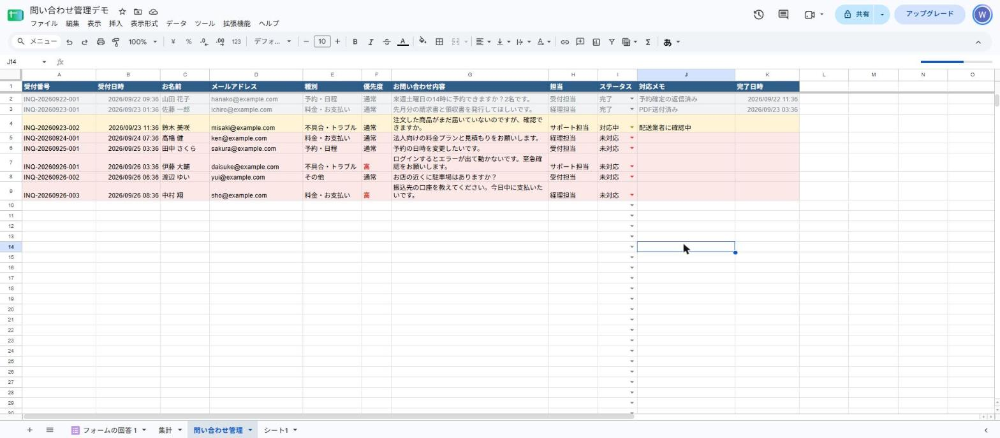
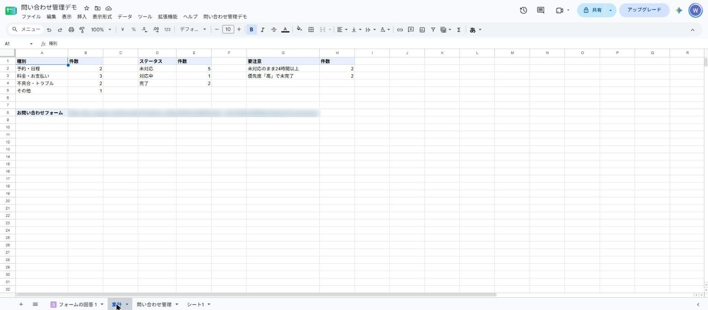

# 問い合わせ管理 自動化デモ（GAS）

Googleフォームに問い合わせが届いたら、自動で次のことをします。

1. 受付番号を振る（例：INQ-20260926-001）
2. 内容から **種別**（予約・日程／料金・お支払い／不具合・トラブル／その他）を判定
3. 「至急」「今日中」などが入っていれば **優先度：高**
4. 種別ごとに **担当** を振り分けて、管理シートに1行追加
5. 担当者に通知メール、問い合わせした人に受付完了メール
6. ステータスを「完了」にすると **完了日時** を自動記入
7. 毎朝9時、**24時間以上「未対応」** の問い合わせをまとめて通知
8. 「集計」シートで種別別・ステータス別の件数を表示

## スクリーンショット

**管理シート** … 種別・優先度・担当が自動で入り、ステータスで色分けされます



**集計シート** … 種別別・ステータス別・要注意の件数を表示します



## ファイル構成

| ファイル | 内容 |
|---|---|
| `Code.gs` | Apps Script 本体（これ1つをスプレッドシートに貼り付けて使います） |
| `test.js` | 判定ロジックのテスト（Node.js） |

> **デモモード（初期設定）では、メールはすべて自分宛てに届きます。**
> 件名に `[DEMO]`、本文の先頭に「本来の宛先」が入ります。他人にメールが飛ぶことはありません。

---

## 設定手順（10分）

1. Googleドライブで **新しいスプレッドシート** を作る（名前は「問い合わせ管理デモ」など）
2. メニュー「拡張機能」→「Apps Script」を開く
3. 最初からある `コード.gs` の中身を全部消して、`Code.gs` の中身を貼り付けて保存
4. 上の関数選択で `setup` を選び「実行」
   - 「承認が必要です」→ 自分のアカウントを選ぶ
   - 「このアプリは Google で確認されていません」→「詳細」→「（安全ではないページ）に移動」→「許可」
     （自分で作ったスクリプトなので出る表示です）
5. スプレッドシートを再読み込みすると、メニューに「問い合わせ管理デモ」が出ます
6. 「問い合わせ管理デモ」→「② サンプルデータを入れる」
   - 架空の問い合わせ8件が入ります（メールは送りません）
   - 2回押すと2セット入るので注意

## 動作確認

- 「集計」シートの **フォームURL** を開いて、自分のメールアドレスで問い合わせを送る
  → 管理シートに行が増え、自分宛てに `[DEMO]` のメールが2通（担当通知・自動返信）届けばOK
- 内容に「至急」を入れると優先度が「高」になり、件名に「至急」が付く
- 管理シートのステータスを「完了」にする → 完了日時が入る
- 「問い合わせ管理デモ」→「放置チェックを今すぐ実行」
  → サンプルデータの「未対応・24時間以上」2件をまとめた通知メールが届く

## 本番で使うときに変えるところ（Code.gs の上の方）

- `DEMO_MODE: false` … 実際の宛先にメールを送る
- `SHOP_NAME` … 店名
- `CATEGORIES` … 種別とキーワード
- `ASSIGNEES` … 種別ごとの担当者名とメールアドレス
- `URGENT_KEYS` … 優先度「高」にする言葉

## テスト（開発用）

判定ロジック（種別・優先度・受付番号・放置検知）は Node.js で確認できます。

```
node test.js
```
